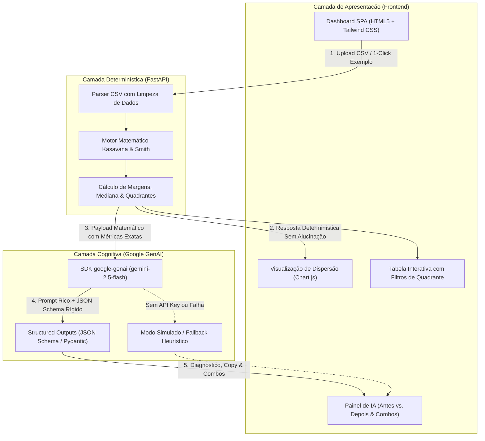

# 🍔 MenuPilot AI — Copiloto de Engenharia de Cardápio & Vendas para Delivery

https://menupilot-ai-chi.vercel.app/

[](https://fastapi.tiangolo.com)
[](https://ai.google.dev/)
[](https://www.chartjs.org/)
[](https://vercel.com)

> **Copiloto inteligente de alta performance para restaurantes parceiros de delivery (estilo iFood, Rappi e Uber Eats).**  
> Une a precisão matemática da **Engenharia de Cardápio (Matriz Kasavana & Smith / BCG)** com a persuasão de conversão do **Google Gemini 2.5 Flash via Structured Outputs**.

---

## 🎯 1. Visão de Negócio & Oportunidade

No ecossistema de delivery, mais de **78% dos restaurantes parceiros precificam e organizam seus cardápios por intuição**, cometendo dois erros fatais de margem:
1. **Canibalização por itens populares de margem baixa:** Pratos como o tradicional *Cheeseburger* concentram a maior parte dos pedidos, gerando alto estresse de cozinha e frete sem gerar lucro real.
2. **Pratos "Quebra-cabeça" invisíveis:** Itens nobres com alta margem unitária (como hambúrgueres artesanais de queijo brie ou sobremesas belgas) permanecem estagnados porque possuem descrições burocráticas ("pão, carne e queijo") e fotos mal posicionadas.

### Como o MenuPilot AI resolve isso?
- **Classificação Científica Automática:** Processa pedidos e custos para classificar cada item nos 4 quadrantes clássicos:
  - ⭐ **Estrelas (Stars):** Alta Venda + Alta Margem (Proteger e manter destaque).
  - 🐎 **Cavalos de Batalha (Plowhorses):** Alta Venda + Baixa Margem (Iscas de tráfego para ancoragem).
  - 🧩 **Quebra-cabeças (Puzzles):** Baixa Venda + Alta Margem (Alvo de copywriting sensorial e fotos apetitosas).
  - 🐕 **Cães (Dogs):** Baixa Venda + Baixa Margem (Reformulação de receita, reajuste ou eliminação).
- **IA Generativa com Foco em Vendas:** O Google Gemini 2.5 Flash reescreve as descrições dos pratos com técnicas de *neuromarketing gastronômico* (textura, crocância sonora, contrastes de sabor) e monta combos matematicamente lucrativos pareando itens de alto tráfego com itens de alta margem.

---

## 🏛️ 2. Arquitetura do Sistema



---

## 💡 3. Decisões Técnicas Fundamentais

### ⚖️ Separação Rígida: Cálculo Determinístico vs. Geração por LLM
Modelos de linguagem (LLMs) são excepcionais em criatividade e linguagem natural, mas propensos a **alucinações aritméticas** quando solicitados a calcular margens percentuais, medianas e somatórios financeiros.
- **Toda a matemática é executada em Python puro (`api/calculator.py`):** margens unitárias, linhas de corte pela mediana de pedidos e média de rentabilidade são calculadas com precisão contábil.
- **O LLM recebe os números já consolidados:** o Gemini 2.5 Flash recebe os quadrantes e margens já validados e foca estritamente naquilo em que é imbatível: **persuasão, apelo sensorial, psicologia de cardápio e estratégia comercial de combos**.

### 🔒 Structured Outputs com Pydantic & JSON Schema
Utilizando o SDK oficial `google-genai` com `GenerateContentConfig(response_schema=AIReportOutput, response_mime_type="application/json")`, o modelo retorna uma árvore JSON estritamente tipada. Não há risco de quebra de layout por markdown solto ou texto fora de formato.

### ⚡ Zero Atrito no Portfólio
- **1-Clique para Teste:** Botão direto no topo carrega instantaneamente uma base completa de hamburgueria artesanal com 16 itens perfeitamente distribuídos nos 4 quadrantes.
- **Modo Demonstração Gratuito com Fallback:** Se o avaliador não possuir ou não quiser informar uma `GEMINI_API_KEY`, a aplicação opera com um gerador heurístico completo, permitindo que qualquer pessoa teste 100% da interface e dos fluxos sem barreiras de autenticação.

---

## 🚀 4. Instalação e Execução Local em 3 Passos

### Pré-requisitos
- Python 3.10 ou superior instalado.
- Chave de API do Google Gemini (opcional para testes ao vivo, obtenha em [Google AI Studio](https://aistudio.google.com/)).

### Passo 1: Clonar o Repositório e Instalar Dependências
```bash
# Clone o repositório
git clone https://github.com/seu-usuario/menupilot-ai.git
cd menupilot-ai

# Instale os pacotes necessários
pip install -r requirements.txt
```

### Passo 2: Configurar Variáveis de Ambiente (Opcional)
```bash
# Copie o arquivo de exemplo
cp .env.example .env

# Abra o .env e adicione sua chave:
# GEMINI_API_KEY=AIzaSy...
```
*(Se preferir, você também pode inserir a chave diretamente pela interface na página web).*

### Passo 3: Iniciar o Servidor
```bash
python main.py
```
Ou diretamente com Uvicorn:
```bash
uvicorn api.index:app --reload --port 8000
```

Abra seu navegador em **`http://localhost:8000`** e comece a explorar!

---

## ☁️ 5. Deploy Unificado na Vercel

O projeto foi estruturado com arquitetura híbrida otimizada para Serverless na Vercel:
- **`api/index.py`:** Função serverless em Python que responde pelos endpoints `/api/*`.
- **`public/`:** Servida diretamente pela CDN da Vercel com latência ultra-baixa.
- **`vercel.json`:** Roteamento automático configurado.

### Passos para Deploy:
1. Faça o push do código para o GitHub.
2. Acesse [vercel.com](https://vercel.com) e importe o repositório.
3. Nas configurações de **Environment Variables** da Vercel, adicione:
   - `GEMINI_API_KEY` = `sua_chave_do_google_ai_studio`
4. Clique em **Deploy**. Sua aplicação estará online em menos de 2 minutos!

---

## 📊 6. Formato do Dataset CSV (`sample_menu.csv`)

O sistema aceita qualquer arquivo `.csv` (com delimitador `,` ou `;`) contendo as colunas:

| Coluna | Tipo | Exemplo | Descrição |
| :--- | :--- | :--- | :--- |
| `id` | Texto / Int | `1` | Identificador único do item |
| `item_name` | Texto | `Bacon BBQ Supreme` | Nome exibido no cardápio |
| `category` | Texto | `Burgers` | Categoria no app (Burgers, Bebidas, etc.) |
| `current_description` | Texto | `Pão, carne, bacon e barbecue` | Descrição atual do prato |
| `price` | Float / Moeda | `42.00` | Preço de venda ao consumidor (R$) |
| `cost` | Float / Moeda | `14.50` | Custo de insumos / CMV (R$) |
| `monthly_orders` | Inteiro | `420` | Quantidade de pratos vendidos no mês |

---

## 📄 7. Licença e Autoria

Desenvolvido para fins de **portfólio técnico, engenharia de software fullstack e consultoria para o setor de Food Service**.
Sinta-se à vontade para utilizar, estender e customizar para o seu restaurante parceiro!
